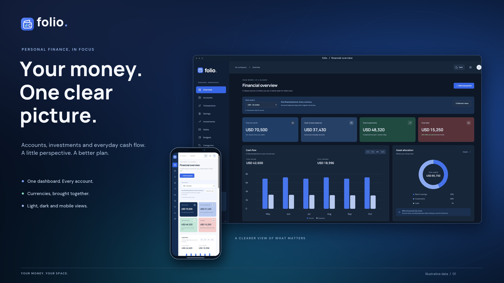
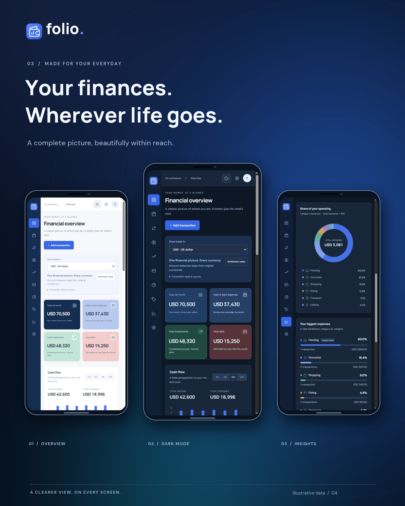

# folio.

**Your money. One clear picture.**

Folio is a self-hosted personal finance dashboard for accounts, savings, investments, debts, and cash flow. Register with an email, name or nickname, and password; each account gets a separate SQLite workspace.



## What you can do

- Track bank accounts, savings, cash, investments, and debts.
- Keep each account in its own currency, including USD, CAD, and NGN.
- View unified totals using available reference exchange rates.
- Record transactions and transfers; organize spending with editable categories and icons.
- Review category spending percentages and weekly or monthly cash flow.
- Set budgets, export reports, and import or export backups.
- Switch between light and dark themes, with layouts for desktop and mobile.
- Give each registered user a private workspace.

Folio uses manual entries. It does not connect to your bank, execute trades, or move money. Reference conversions are estimates, not transaction exchange rates. Screenshots use illustrative data.

## Start locally

Install **Node.js 24.15 or newer**, then:

```sh
git clone https://github.com/errice/folio.git
cd folio
npm start
```

Open **http://127.0.0.1:4175/register** and create your account. No dependency installation is needed; the server uses Node's built-in HTTP, crypto, and SQLite modules. New accounts start empty.

If you prefer to run Node directly:

```sh
node standalone/server.mjs
```

The default database is `data/folio.sqlite`. Keep it and its backups private. It is excluded from Git.

## Hosting

For free Cloudflare Workers hosting with a D1 (SQLite) database and independent email/password registration, see the [Cloudflare deployment guide](cloudflare/README.md). The instructions below apply to the Node edition.

The app needs a Node server, HTTPS, and persistent storage for SQLite. A Dockerfile and Compose configuration are included. See [deployment and migration instructions](standalone/README.md).

Production configuration must include your external HTTPS origin, for example `PUBLIC_ORIGIN=https://finance.example.com`. Production startup rejects a missing HTTPS origin. `ALLOW_REGISTRATION=false` closes new registrations while allowing existing users to log in.

Free hosting with an ephemeral filesystem will not preserve this local database. A hosted database connection, such as Turso, would require an adapter that is **not included** in this release. Do not deploy this edition with an unpersisted SQLite file.

To configure local environment variables, copy `.env.example` to `.env`; `npm start` reads it if present. Do not commit `.env`.

## Tests

```sh
npm test
```

The suite checks account registration, credential handling, sessions, database persistence, per-user isolation, account switching between tabs, rejected cross-origin writes, conflicting saves, currency conversion, and the seven-day cash-flow view.

## Account features and current limitations

The avatar menu provides profile editing, password changes, and logout. A password change requires the current password, rotates the current session, and revokes other sessions. Your sign-in email is read-only.

Passwords are salted and hashed with scrypt. Session cookies are HttpOnly, use SameSite protection, and are Secure on HTTPS. Every financial request is scoped to the session's user; stale tabs cannot write into a newly signed-in account. Login attempts are limited. Financial records and passwords are not stored in browser storage.

Email verification, password-reset emails, and an administrator dashboard are not implemented. Registration accepts an email address without verifying mailbox ownership. There is no configured email-delivery service. Read [security and data-handling notes](SECURITY.md) before a public deployment.

## License: free to use; permission required to sell

You may use, study, modify, self-host, and share Folio for free, including for internal business use. **Selling Folio or modified versions, offering paid access, or bundling it as a material part of a paid product requires prior written permission from Mr Chris (@errice).**

This makes Folio **source-available**, not OSI-approved open source. See the [Folio Community License](LICENSE) for the full terms and [third-party notices](THIRD_PARTY_NOTICES.md) for components with their own licenses.

For permission to sell, [contact @errice](https://github.com/errice) and obtain a written agreement before commercial distribution or paid hosting.

## Mobile views


